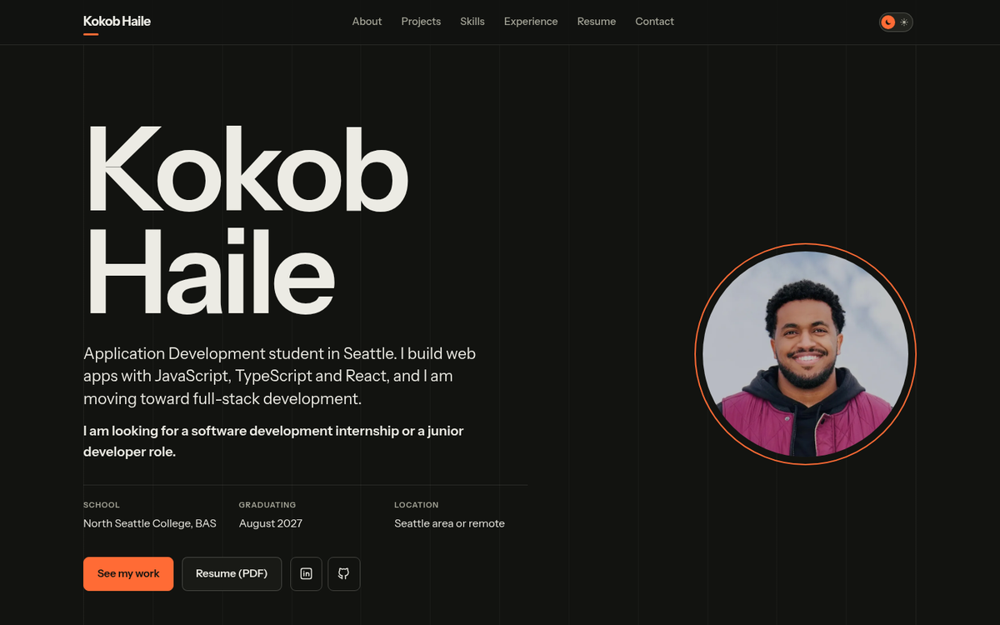

# Kokob Haile, developer portfolio

My personal portfolio website. I am an Application Development (BAS) student at North Seattle College, and this site shows my projects, skills and experience.

Live site: [https://koki-star.github.io/](https://koki-star.github.io/)



## Built with

- React 18 and TypeScript (strict mode)
- Vite
- Plain CSS, with one file for each component
- ESLint
- Self-hosted fonts from Fontsource

No UI libraries and no CSS frameworks.

## Sections

About me, Projects, Skills, Experience and education, Resume and Contact.

## Project structure

```
├── index.html          page shell and the script that sets the theme
├── public/             photo, resume PDF, site icon, project screenshots
├── src/
│   ├── App.tsx         puts all sections in order
│   ├── types.ts        types for all the content
│   ├── data/           page content: profile, projects, skills, experience
│   ├── components/     one component for each part of the page, with its CSS
│   ├── hooks/          theme, fade-in, active nav section, email
│   ├── lib/            small helpers
│   └── styles/         global styles and motion rules
```

## How it works

- **Content is data.** All text and links live in `src/data/`. Components only display them, so I change a project or a skill in one file.
- **Small components.** For example, `Projects` renders a list of `ProjectCard`, and the contact card is made of `ContactRow` and `CopyEmailButton`.
- **Hooks for behavior.** The theme, the fade-in, the nav highlight and the email each have their own hook.

## Design

- Dark theme by default, with a switch for light. The choice is saved in the browser.
- One orange accent color, large type for my name and a visible column grid.
- Responsive for phone, tablet and desktop.
- Small hover and click effects on links, buttons, cards and the photo.
- A scroll progress bar and section titles that reveal as you scroll, built with CSS scroll-driven animations.
- Accessible: semantic HTML, a skip link, visible focus styles, alt text and WCAG AA color contrast. Motion turns off when the system asks for reduced motion.
